# Estudos Complementares — Laboratório de Treino para Entrevistas Técnicas

Treino diário para entrevistas e testes técnicos, na stack e no nível que você definir no seu perfil (**Júnior, Pleno ou Sênior**). O conteúdo vem em **trilhas** (`trilhas/`); a que acompanha este repositório é a de **Backend .NET**, e você escolhe a sua no perfil. Um assistente de IA (o [Claude Code](https://claude.com/claude-code)) atua como **avaliador**: faz perguntas, corrige com tom acolhedor e **nunca entrega a resposta de início**.

O foco é **responder sob pressão, explicar o porquê e mostrar com clareza o que você já sabe**. A nota de comunicação pesa tanto quanto o acerto técnico.

---

## Como começar

1. Instale o [Claude Code](https://claude.com/claude-code) e clone este repositório.
2. Abra o Claude Code **nesta pasta**. O [CLAUDE.md](CLAUDE.md) carrega as [regras](assistente/regras-do-assistente.md).
3. Peça um treino escrevendo o comando dentro de uma frase, por exemplo: "vamos fazer uma /sessao". Se a mensagem começar com `/`, o Claude Code pode tratá-la como um comando próprio e dar erro.
4. **Na primeira vez**, o assistente faz uma entrevista curta (nível-alvo, tecnologias que você domina, pontos fracos, dificuldades de comunicação) e cria o seu perfil em `meus-estudos/perfil.md`. Sem ele, nenhuma sessão é gerada.
5. O assistente cria `meus-estudos/sessoes/NN-sessao.md`. **Responda dentro do arquivo**, respeitando o limite de linhas, e peça "corrija a sessão NN". A correção, a nota geral e os insights entram no mesmo arquivo.
6. Registre os 🔴 no diário ([modelo](modelos/diario.modelo.md)).

> **Seus dados ficam fora deste repositório.** Tudo o que é pessoal (perfil, progresso, sessões, gabaritos e diário) vive em `meus-estudos/`, que está no `.gitignore`. O repositório traz apenas os modelos.
>
> **Quer os dados em várias máquinas?** Faça de `meus-estudos/` um repositório **privado** seu: dentro da pasta, rode `git init`, crie um repositório privado no GitHub e envie com `git push`. Em outra máquina, clone este projeto e depois `git clone <seu-repo-privado> meus-estudos`.

> **Aviso:** [trilhas/dotnet/pegadinhas-gabarito.md](trilhas/dotnet/pegadinhas-gabarito.md) é material **do assistente** e contém as respostas das pegadinhas. Para treinar de verdade, não abra esse arquivo.

---

## Comandos

| Comando | O que faz | Duração |
|---|---|---|
| `/sessao` | **Treino diário:** 10 perguntas sortidas de módulos variados | ~20 min |
| `/rapido` | 3 perguntas sortidas, para dias corridos | ~5 min |
| `/treino [tema]` | 2 perguntas de um tema ou módulo | ~5 min |
| `/ache-o-erro` | Um bloco de código com um erro oculto | 2 min |
| `/logica` | Desafio rápido de sequência ou raciocínio | 2–3 min |
| `/simulado-20min` | 6 a 8 questões densas e variadas | 20 min |
| `/modo-entrevista` | Perguntas orais, sem código | 10 min |
| `/mostre-o-que-sabe` | Perguntas abertas ("fale da sua experiência com X") | 10 min |
| `/revisao-semanal` | Refaz os temas errados da semana | 15 min |
| `/ensina [tema]` | Explica um conceito novo, sem nota | livre |

O sorteio é **ponderado pelos seus erros** (veja as [regras](assistente/regras-do-assistente.md)).

---

## Como uma sessão nasce e é corrigida

```mermaid
flowchart TD
    A["Você pede uma /sessao"] --> B{"Existe meus-estudos/perfil.md?"}
    B -- Não --> B1["Entrevista de configuração<br/>e criação do perfil"] --> C
    B -- Sim --> C["Lê perfil, progresso e diário de erros"]

    subgraph CRIACAO["1. Criação da sessão e do gabarito"]
        C --> D["Sorteia os tópicos<br/>40% erros · 20% revisão · 25% inéditos · 15% aleatório"]
        D --> E["Consulta cenarios-usados.md<br/>só nas etiquetas sorteadas"]
        E --> F["Monta a ficha de cada pergunta<br/>cenário, resposta única, pedido, premissas"]
        F --> G["Escreve o enunciado<br/>e o gabarito a partir da mesma ficha"]
        G --> H["Auditoria leve<br/>e correção só do que falhar"]
        H --> I["Grava sessoes/NN-sessao.md<br/>gabaritos/NN-gabarito.md<br/>e atualiza cenarios-usados.md"]
    end

    I --> J["Você responde dentro do arquivo<br/>respeitando o limite de linhas"]
    J --> K["Você pede: corrija a sessão NN"]

    subgraph CORRECAO["2. Correção"]
        K --> L["Nota técnica e de comunicação por pergunta<br/>mais o texto Como eu diria na entrevista"]
        L --> M["Bloco Resultado: nota geral,<br/>veredito e insights novos"]
        M --> N["Atualiza historico/AAAA-MM.md<br/>e progresso.md"]
        N --> O["Oferece registrar os 🔴<br/>no diário de erros"]
    end

    O --> P["Você abre o gabarito<br/>só depois de responder, para tirar dúvidas"]
    P --> Q{"Contestou algum enunciado?"}
    Q -- Sim --> R["Reescreve enunciado e gabarito<br/>e desconsidera a pergunta da nota"]
    Q -- Não --> S["Fim da sessão"]
    R --> S
```

**Resumo:** o assistente cria **sessão e gabarito juntos**, a partir da mesma ficha, para que os dois sempre combinem. A **correção só existe depois que você pede** e é escrita no mesmo arquivo, abaixo de cada resposta. O **gabarito** serve para conferir dúvidas e só deve ser aberto depois de responder.

---

## Como a nota funciona

| Marca | Significado |
|---|---|
| 🟢 | Respondeu o que foi pedido, certo e com a justificativa certa |
| 🟡 | Parcial: faltou algo que a pergunta pedia ou a explicação saiu confusa |
| 🔴 | Caiu na pegadinha, sem identificar o problema |
| ⚪ | Sem resposta |
| ⭐ | Pergunta de um nível acima do seu: errar não conta contra você; acertar dá bônus |

Cada resposta recebe também uma **nota de comunicação** (mesmos emojis). No fim da sessão vêm a **nota geral de 0 a 10**, um veredito e alguns insights. A régua muda conforme o nível-alvo do seu perfil.

**Fórmula RPI para responder:** **R**esposta na primeira frase, **P**orquê (o mecanismo) e **I**mpacto em produção, quando couber.

---

## Estrutura

| Pasta | Conteúdo |
|---|---|
| [trilhas/](trilhas/trilhas.md) | Conteúdo por stack. Trilha incluída: [trilhas/dotnet/](trilhas/dotnet/dotnet.md) (Backend .NET) |
| [assistente/](assistente/regras-do-assistente.md) | Regras de como a IA se comporta nas sessões |
| [modelos/](modelos/) | Modelos de perfil, progresso, histórico, sessão e diário |
| `meus-estudos/` | **Local, fora do git:** perfil, progresso, histórico, sessões, gabaritos e diário |

As pastas de `ementas/` de cada trilha são **ementas**, não bancos de perguntas: o assistente gera perguntas novas a cada sessão.

---

## Rotina sugerida

| Frequência | O quê |
|---|---|
| Diário | 1 `/sessao` (ou `/rapido` nos dias corridos) |
| 3x por semana | `/ache-o-erro` e `/logica` de aquecimento |
| Semanal | `/revisao-semanal` |
| Quinzenal | `/simulado-20min` |

---

## Regras de ouro

1. **Responda antes de abrir qualquer gabarito.**
2. **Explique o porquê**, não só a opção certa.
3. **Respeite o limite de linhas.** Síntese faz parte do treino.
4. **Erro sem revisão é só frustração:** leve os 🔴 para o diário.

---

## Licença

[MIT](LICENSE).
